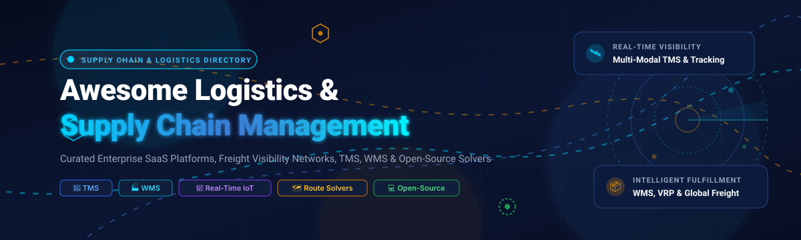

<div align="center">



# 🚚 Awesome Logistics & Supply Chain Management (SCM) 📦

<a href="https://github.com/ishandutta2007/Awesome-Awesome-Awesome"></a><a href="https://discord.gg/jc4xtF58Ve"></a>
[](https://github.com/ishandutta2007/Awesome-Logistics-Supply-Chain-Management/stargazers)
[](https://github.com/ishandutta2007/Awesome-Logistics-Supply-Chain-Management/network/members)
[](LICENSE)
[](https://github.com/ishandutta2007/Awesome-Logistics-Supply-Chain-Management/commits/main)
<a href="https://github.com/ishandutta2007"></a>

<p align="center">
  <strong>A comprehensive, SEO-optimized directory of enterprise Transportation Management Systems (TMS), Warehouse Management Systems (WMS), global freight marketplaces, real-time IoT shipment visibility platforms, and open-source operations research route optimization engines.</strong>
</p>

---

</div>

## 📑 Table of Contents

- [🌐 Sector Overview & Market Dynamics](#-sector-overview--market-dynamics)
- [🌟 Architecture & Core Pillars](#-architecture--core-pillars)
- [🏢 SaaS & Commercial Supply Chain Platforms](#-saas--commercial-supply-chain-platforms)
- [💻 Open-Source Logistics & SCM Projects](#-open-source-logistics--scm-projects)
- [🛠️ Architectural Building Blocks & Frameworks](#️-architectural-building-blocks--frameworks)
- [🤝 How to Contribute](#-how-to-contribute)
- [💖 Support](#-support)
- [📈 Star History](#-star-history)
- [⚠️ Disclaimer](#️-disclaimer)

---

## 🌐 Sector Overview & Market Dynamics

The global **Logistics & Supply Chain Management (SCM) Software** market is valued at approximately **$24.2 Billion** in 2024 and is projected to expand to over **$52.8 Billion** by 2032 (CAGR ~10.2%), driven by omni-channel fulfillment demands, AI-powered predictive dispatching, and geopolitical re-shoring. 

The industry demonstrates a **moderately fragmented** structure: foundational ERP, WMS, and deep execution layers are concentrated among enterprise incumbents (Manhattan Associates, Blue Yonder, Descartes, WiseTech Global), whereas freight booking networks, digital forwarding, and real-time shipment visibility (Project44, FourKites, Freightos, Flexport) experience high competition across multi-modal carrier niches.

---

## 🌟 Architecture & Core Pillars

Modern logistics tech stacks link physical operations (ocean freighters, intermodal rail, trucking fleets, and automated warehouses) with cloud-native coordination engines:

```
┌─────────────────┐       ┌─────────────────┐       ┌─────────────────┐       ┌─────────────────┐       ┌─────────────────┐
│ 📡 Real-Time IoT│ ───▶  │ 🗺️ Dynamic Route│ ───▶  │ 🏭 WMS & Yard   │ ───▶  │ 🚢 Global Multi-│ ───▶  │ 📊 Financial GL │
│ Telematics/Sensors     │ Optimization    │       │ Inventory Ops   │       │ Modal TMS Hub   │       │ & Freight Audit │
└─────────────────┘       └─────────────────┘       └─────────────────┘       └─────────────────┘       └─────────────────┘
```

### 🎯 Key Evaluation Pillars
- **🚚 Transportation Management Systems (TMS)**: Multi-carrier rate rating, automated load tendering, dispatching, and dynamic route sequencing.
- **🏭 Warehouse Management Systems (WMS)**: Real-time inventory bin tracking, wave picking, cross-docking, and automated storage and retrieval systems (ASRS).
- **🛰️ Real-Time Visibility & Telematics**: Sub-second GPS ELD tracking, geofencing, IoT condition monitoring (temperature, shock, humidity), and predictive ETA algorithms.
- **🌐 Digital Freight Forwarding & Customs**: Automated customs declarations, ocean container tracking, air bill processing, and dynamic spot rate clearinghouse APIs.
- **🧠 Operations Research & VRP Solvers**: Mixed-Integer Linear Programming (MILP), metaheuristics, and Vehicle Routing Problem (VRP) solvers with time-windows and capacity constraints.

---

## 🏢 SaaS & Commercial Supply Chain Platforms

*The leading commercial SaaS and hosted Logistics & Supply Chain Management solutions, ranked in descending order by **Company Size (Market Capitalization / Valuation / Annual Revenue)**.*

| Platform | Company Size (Valuation / Revenue) | Description & Key Capabilities | Starting Price | Free Tier / Free Trial Limits |
| :--- | :--- | :--- | :--- | :--- |
| **[Zoho Inventory / Logistics](https://www.zoho.com/inventory/)** | **~$60.0 Billion** Valuation *(Zoho Corporation, ~$1.4B+ Annual ARR, bootstrap)* | End-to-end multi-channel inventory control, warehouse stock picking, purchase order tracking, and integrated shipping carrier dispatch across 40+ shipping services. | **$39/month** *(Standard tier billed annually; Professional at $99/month)* | **Permanent Free Tier:** Up to 50 orders/month, 50 shipping labels/month, 1 warehouse, and 2 users; 14-day free trial on paid plans (no credit card required). |
| **[Blue Yonder](https://blueyonder.com/)** | **~$10.0 Billion** Valuation *(Subsidiary of Panasonic Holdings Corp, TYO: 6752; ~$1.3B+ Annual Revenue)* | Autonomous end-to-end supply chain planning and execution platform powered by AI machine learning for demand forecasting, dynamic pricing, and warehouse optimization. | **~$3,500/month** *(Base SaaS module pricing; typically enterprise contracts starting at ~$40,000–$100,000+/year)* | **30-day sandbox pilot** via enterprise sales engagement and tailored architectural proof-of-concept *(no permanent free tier)*. |
| **[WiseTech Global (CargoWise)](https://www.wisetechglobal.com/)** | **~$20.5 Billion** MktCap *(ASX: WTC; ~$1.04B+ Annual Revenue)* | Mission-critical cloud logistics platform used by top freight forwarders globally for customs processing, international ocean/air forwarding, and multi-modal freight management. | **~$1,500/month** *(Base CargoWise system fee + transaction consumption charges starting ~$2.00–$6.50 per bill of lading)* | **14-day guided sandbox proof-of-concept** for registered commercial logistics forwarders *(no permanent free tier)*. |
| **[Manhattan Associates](https://www.manh.com/)** | **~$15.2 Billion** MktCap *(NASDAQ: MANH; ~$950M+ Annual Revenue)* | Leading cloud-native supply chain commerce suite uniting enterprise Warehouse Management (WMS), Transportation Management (TMS), and Omni-channel order routing. | **~$5,000/month** *(Manhattan Active WMS / TMS cloud modules starting at ~$60,000+/year based on facility scale)* | **30-day structured proof-of-concept** with synthetic facility topology upon enterprise consultation *(no permanent free tier)*. |
| **[Descartes Systems Group](https://www.descartes.com/)** | **~$8.6 Billion** MktCap *(NASDAQ: DSGX / TSX: DSG; ~$550M+ Annual Revenue)* | Global Logistics Network (GLN) SaaS uniting multi-carrier TMS, routing & scheduling, customs compliance, and real-time electronic data interchange (EDI) messaging. | **~$500/month** *(Entry routing modules; enterprise route scheduling packages starting at ~$25,000+/year)* | **14-day interactive test sandbox** available on select fleet tracking modules upon demo consultation *(no permanent free tier)*. |
| **[Flexport](https://www.flexport.com/)** | **~$8.0 Billion** Valuation *(Privately held, backed by Andreessen Horowitz, SoftBank, Founders Fund)* | Digital-first global freight forwarding and supply chain platform delivering real-time cargo visibility, ocean/air booking, customs brokerage, and fulfillment. | **$0/month** base software access *(Standard pay-as-you-go per freight shipment / container booking)* | **Permanent Free Tier:** Unlimited dashboard access, shipment tracking, document archiving, and inventory analytics when booking freight with Flexport. |
| **[Project44](https://www.project44.com/)** | **~$2.7 Billion** Valuation *(Series F unicorn, backed by Goldman Sachs, Insight Partners)* | High-velocity supply chain visibility platform tracking over 1 billion shipments annually across ocean, air, rail, truckload, and parcel with predictive ETAs. | **~$1,000/month** *(Movement platform entry tier based on tracked container/load volume)* | **30-day Movement Visibility sandbox trial** for qualified enterprise carrier/shipper accounts *(no permanent free tier)*. |
| **[FourKites](https://www.fourkites.com/)** | **~$1.5 Billion** Valuation *(Series D unicorn, backed by Qualcomm Ventures, Zebra Technologies)* | Real-time predictive supply chain visibility platform tracking over 3.2 million daily shipments across road, rail, ocean, air, and yard management. | **~$1,200/month** *(Base subscription tiered by annual shipment volume)* | **14-day guided proof-of-concept pilot** with live ELD/telematics integrations *(no permanent free tier)*. |
| **[Freightos](https://www.freightos.com/)** | **~$120 Million** MktCap *(NASDAQ: CRGO; ~$22M+ Annual Revenue)* | Global freight booking marketplace and SaaS infrastructure connecting air and ocean carriers, freight forwarders, and importers with live comparative rate quotes. | **$0/month** *(Free marketplace search; WebCargo professional tier starts at **€149/month**)* | **Permanent Free Tier:** Free spot quote search and shipment booking portal for shippers; 14-day free trial on WebCargo airline capacity booking. |
| **[Shipwell](https://www.shipwell.com/)** | **~$100 Million** Valuation *(Series B backed by Georgian & Fifth Wall)* | Cloud TMS combining automated freight tendering, real-time load tracking, rate bidding, and dispatching in a unified platform for mid-market shippers and 3PLs. | **$350/month** *(Starter TMS tier; advanced dispatch tiers scale to ~$1,500+/month)* | **14-day free sandbox trial** with simulated shipments and carrier rate comparison *(no permanent free tier)*. |

---

## 💻 Open-Source Logistics & SCM Projects

*Active open-source platforms, ERP distribution engines, routing solvers, and telematics systems for Logistics and Supply Chain Management, ranked in descending order by **GitHub Star Count**.*

- 🌟 **[Odoo Community](https://github.com/odoo/odoo)** [](https://github.com/odoo/odoo/stargazers)  
  Comprehensive open-source enterprise suite featuring full-featured Warehouse Management (WMS), Inventory barcode scanning, automated replenishment, cross-docking, multi-warehouse routing rules, and multi-carrier delivery tracking connectors.

- 🌟 **[ERPNext / Frappe](https://github.com/frappe/erpnext)** [](https://github.com/frappe/erpnext/stargazers)  
  100% open-source Python/Frappe ERP with extensive supply chain capabilities: purchase order lifecycle, serialized and batch inventory tracking, multi-currency landed cost computation, automated stock balance reconciliation, and delivery trips management.

- 🌟 **[Google OR-Tools](https://github.com/google/or-tools)** [](https://github.com/google/or-tools/stargazers)  
  Fast and portable open-source software suite for solving combinatorial optimization problems, including the Vehicle Routing Problem (VRP, CVRP, VRPTW), traveling salesperson (TSP), bin packing, and job-shop scheduling.

- 🌟 **[Project OSRM Backend](https://github.com/Project-OSRM/osrm-backend)** [](https://github.com/Project-OSRM/osrm-backend/stargazers)  
  High-performance C++ open-source routing engine designed to run on OpenStreetMap road networks. Computes shortest paths, generates turn-by-turn logistics navigation, and solves massive distance/duration matrix queries in sub-milliseconds.

- 🌟 **[Traccar](https://github.com/traccar/traccar)** [](https://github.com/traccar/traccar/stargazers)  
  Leading open-source GPS tracking and fleet telematics platform supporting over 200+ GPS communication protocols and thousands of hardware tracker models, featuring live geofencing, speed alerts, and driver behavior analysis.

- 🌟 **[InvenTree](https://github.com/inventree/InvenTree)** [](https://github.com/inventree/InvenTree/stargazers)  
  Modern Python/Django open-source inventory and parts management system with intuitive stock tracking, barcode/QR label printing, supplier management, and automated stock level alerts.

- 🌟 **[GraphHopper](https://github.com/graphhopper/graphhopper)** [](https://github.com/graphhopper/graphhopper/stargazers)  
  Fast, memory-efficient open-source Java road routing and logistics optimization engine based on OpenStreetMap data, supporting custom vehicle profiles, matrix calculations, and turn-by-turn transit instructions.

- 🌟 **[Valhalla](https://github.com/valhalla/valhalla)** [](https://github.com/valhalla/valhalla/stargazers)  
  Open-source routing engine and microservices architecture for OpenStreetMap featuring hierarchical tiled data storage, time-dependent routing, multimodal transit planning, and map matching.

- 🌟 **[GreaterWMS](https://github.com/GreaterWMS/GreaterWMS)** [](https://github.com/GreaterWMS/GreaterWMS/stargazers)  
  Completely open-source, multi-platform Warehouse Management System (WMS) born from automotive after-sales supply chain processes, featuring scanning terminals, multi-location stock picking, packing, and dispatch.

- 🌟 **[metasfresh](https://github.com/metasfresh/metasfresh)** [](https://github.com/metasfresh/metasfresh/stargazers)  
  Responsive, scalable open-source ERP system built with Java and React, engineered specifically for fast-paced wholesale, food logistics, automated order processing, and consignment inventory.

- 🌟 **[OpenRouteService](https://github.com/GIScience/openrouteservice)** [](https://github.com/GIScience/openrouteservice/stargazers)  
  Spatial services engine consuming OpenStreetMap data to provide vehicle routing, isochrones (reachability contours), distance matrices, and point-of-interest geocoding for logistics networks.

- 🌟 **[VROOM](https://github.com/VROOM-Project/vroom)** [](https://github.com/VROOM-Project/vroom/stargazers)  
  Vehicle Routing Open-source Optimization Machine: Fast C++ heuristic optimization engine providing high-speed solutions for multi-vehicle routing problems with time windows, capacities, and driver skill constraints.

- 🌟 **[Timefold Solver](https://github.com/TimefoldAI/timefold-solver)** [](https://github.com/TimefoldAI/timefold-solver/stargazers)  
  Lightweight, fast open-source AI constraint solver (the successor to OptaPlanner) for Java/Kotlin and Python that optimizes complex vehicle fleet dispatching, capacity-constrained routing, and warehouse bin allocation.

- 🌟 **[pgRouting](https://github.com/pgRouting/pgrouting)** [](https://github.com/pgRouting/pgrouting/stargazers)  
  PostGIS geospatial database extension adding routing and network analysis functionality (Dijkstra, A*, Traveling Salesperson, Vehicle Routing) directly inside PostgreSQL.

- 🌟 **[OpenBoxes](https://github.com/openboxes/openboxes)** [](https://github.com/openboxes/openboxes/stargazers)  
  Open-source supply chain and warehouse management system designed to track inventory, lots, expiration dates, and shipments across healthcare networks and humanitarian missions.

- 🌟 **[Apache OFBiz](https://github.com/apache/ofbiz)** [](https://github.com/apache/ofbiz/stargazers)  
  Mature open-source suite of enterprise business applications providing warehouse management, fulfillment routing, inventory accounting, and manufacturing resource planning (MRP).

- 🌟 **[OpenWMS.org](https://github.com/openwms/org.openwms)** [](https://github.com/openwms/org.openwms/stargazers)  
  Modern, microservices-based open-source Warehouse Management System (WMS) built on Spring Boot, managing Transport Units (TU), transport orders, conveyor controls, and automated storage.

---

## 🛠️ Architectural Building Blocks & Frameworks

For engineering teams designing bespoke, cloud-native logistics pipelines:

| Component Category | Recommended Open-Source Engines & Tools | SCM & Logistics Use Case |
| :--- | :--- | :--- |
| **🗺️ Geospatial & Spatial DB** | [PostGIS](https://postgis.net/), [H3 (Uber)](https://github.com/uber/h3), [S2 Geometry](https://github.com/google/s2geometry) | Hexagonal spatial indexing, geofence polygons, and high-speed GPS coordinate proximity queries. |
| **🧠 Combinatorial Optimization** | [Google OR-Tools](https://github.com/google/or-tools), [Timefold Solver](https://github.com/TimefoldAI/timefold-solver), [VROOM](https://github.com/VROOM-Project/vroom) | Multi-stop dispatching, dynamic fleet routing with time windows (VRPTW), and trailer load packing. |
| **📡 Telematics & IoT Ingestion** | [Traccar](https://github.com/traccar/traccar), [EMQX](https://github.com/emqx/emqx), [Apache Kafka](https://github.com/apache/kafka) | High-throughput MQTT ingestion for continuous ELD truck telematics, cold-chain temperature monitors, and beacon sensors. |
| **📑 EDI & Trade Standards** | [Stedi EDI Engine](https://www.stedi.com/), ANSI X12 (EDI 204, 210, 214, 990), EDIFACT | Parsing load tenders (EDI 204), shipment status messages (EDI 214), and freight carrier invoices (EDI 210). |
| **⚙️ Workflow Orchestration** | [Temporal](https://github.com/temporalio/temporal), [Apache Airflow](https://github.com/apache/airflow) | Orchestrating multi-party freight milestones, driver dispatch confirmation, customs status callbacks, and carrier invoice reconciliation. |

---

## 🤝 How to Contribute

Contributions and new platform additions are warmly welcomed! Help make this ecosystem repository the definitive guide for logistics leaders, supply chain executives, and software engineers:

1. 🍴 **Fork** this repository.
2. 🌿 **Create a new branch**: `git checkout -b feat/add-new-logistics-tool`
3. ✏️ **Add your entry** following the tabular or bulleted format with accurate links, starting pricing, and verified limits.
4. 🚀 **Commit & Push**: `git commit -m "Add [Tool Name] to logistics SCM directory"`
5. 📬 **Submit a Pull Request** with a concise description of why the tool is relevant.

---

## 💖 Support

If you find this curated directory helpful for your projects, operations, or research, please consider showing your support:
- ⭐ **Star** this repository on GitHub to help others discover it!
- 🍴 **Fork** and contribute new tools, libraries, or updates.
- 📢 **Share** it with fellow logistics engineers, supply chain specialists, and developers.
- ☕ **Buy me a coffee**: Support ongoing maintenance and curated open-source research via the [GitHub Sponsors Dashboard](https://github.com/sponsors/ishandutta2007).

---

## 📈 Star History

[](https://www.star-history.com/#ishandutta2007/Awesome-Logistics-Supply-Chain-Management&type=date&legend=top-left)

---

## ⚠️ Disclaimer

- This is a **community-curated** directory intended for informational and educational purposes only.
- Supply chain execution involves physical assets, dangerous goods, and cross-border customs regulations. Always conduct thorough compliance evaluations, security verifications, and SLA reviews before deploying production logistics software.

---

<div align="center">

**Built with ❤️ for Logistics Operators, Supply Chain Directors, Fleet Managers, and Tech Builders.**  
*Let's build more efficient, transparent, and resilient global supply chains.*

</div>
